# Dokumentasi ERD (Entity Relationship Diagram) — EVLAN

Dokumen ini memuat arsitektur database final aplikasi EVLAN (Event Planner Organizer) berdasarkan spesifikasi migrasi Phase 1 (T1.1), Process Specification SRS, dan keputusan arsitektur D-01 s/d D-26.

---

## 1. Diagram ERD (Mermaid)

```mermaid
erDiagram
    roles ||--o{ users : "has"
    users ||--o{ events : "leads (leader_id)"
    users ||--o{ event_members : "joins"
    users ||--o{ tasks : "assigned (penerima_id)"
    users ||--o{ tasks : "creates (created_by)"
    users ||--o| vendors : "owns (user_id)"
    users ||--o{ saved_vendors : "bookmarks"
    users ||--o{ event_registrations : "registers"
    users ||--o{ app_notifications : "receives"
    users ||--o{ activity_logs : "triggers"

    categories ||--o{ templates : "has"
    categories ||--o{ events : "categorizes"

    templates ||--o{ template_items : "contains"

    events ||--o{ checklists : "has"
    events ||--o{ timelines : "schedules"
    events ||--o{ divisions : "structures"
    events ||--o{ event_members : "includes"
    events ||--o{ tasks : "manages"
    events ||--o{ budgets : "estimates"
    events ||--o{ event_registrations : "enrolls"
    events ||--o{ app_notifications : "relates_to"
    events ||--o{ activity_logs : "records"

    divisions ||--o{ event_members : "assigns_to"
    divisions ||--o{ tasks : "categorizes"

    checklists ||--o{ budgets : "linked_to"

    vendors ||--o{ vendor_products : "offers"
    vendors ||--o{ saved_vendors : "saved_by"

    vendor_products ||--o{ budgets : "referenced_in"

    tasks ||--o{ app_notifications : "triggers"

    roles {
        bigint id PK
        string nama UK "admin | user | vendor"
    }

    users {
        bigint id PK
        bigint role_id FK "restrict"
        string nama
        string email UK
        timestamp email_verified_at
        string password
        string no_telepon
        enum status_akun "aktif | nonaktif"
        json preferensi_notifikasi
        string remember_token
        timestamps timestamps
    }

    categories {
        bigint id PK
        string nama_kategori UK
        text deskripsi
        string ikon "Emoji (🎤, 🎂, dll)"
        timestamps timestamps
    }

    templates {
        bigint id PK
        bigint category_id FK "restrict"
        string nama_template
        boolean is_aktif
        timestamps timestamps
    }

    template_items {
        bigint id PK
        bigint template_id FK "cascade"
        enum jenis "kebutuhan | timeline | divisi | jobdesk"
        string nama_item
        string kelompok
        text deskripsi
        smallint offset_hari
        smallint urutan
        timestamps timestamps
    }

    events {
        bigint id PK
        bigint leader_id FK "users restrict"
        bigint category_id FK "categories restrict"
        string nama_event
        text tujuan
        date tanggal
        time waktu_mulai
        time waktu_selesai
        string lokasi
        string target_peserta
        integer jumlah_peserta
        enum status_event "perencanaan | selesai"
        text evaluasi
        timestamp closed_at
        string penyelenggara
        boolean is_publik
        boolean pendaftaran_dibuka
        date batas_pendaftaran
        integer kuota
        timestamps timestamps
    }

    checklists {
        bigint id PK
        bigint event_id FK "cascade"
        string nama_kebutuhan
        string kelompok
        boolean dari_template
        boolean status_selesai
        smallint urutan
        timestamps timestamps
    }

    timelines {
        bigint id PK
        bigint event_id FK "cascade"
        string label "H-60, Hari H"
        smallint offset_hari
        date tanggal
        string kegiatan
        smallint urutan
        timestamps timestamps
    }

    divisions {
        bigint id PK
        bigint event_id FK "cascade"
        string nama_divisi
        timestamps timestamps
    }

    event_members {
        bigint id PK
        bigint event_id FK "cascade"
        bigint user_id FK "cascade"
        bigint division_id FK "nullOnDelete"
        enum peran "koordinator | anggota"
        timestamps timestamps
    }

    tasks {
        bigint id PK
        bigint event_id FK "cascade"
        bigint division_id FK "nullOnDelete"
        bigint penerima_id FK "users restrict"
        bigint created_by FK "users restrict"
        string judul
        text deskripsi
        date deadline
        enum status "belum_dikerjakan | sedang_dikerjakan | sudah_diselesaikan"
        timestamp completed_at
        timestamps timestamps
    }

    vendors {
        bigint id PK
        bigint user_id FK "users cascade UK"
        string nama_vendor
        string kategori_vendor "catering | dekorasi | dll"
        text alamat
        string kota
        string kontak
        text deskripsi
        enum status_verifikasi "menunggu | terverifikasi | ditolak"
        text alasan_penolakan
        timestamp verified_at
        timestamps timestamps
    }

    vendor_products {
        bigint id PK
        bigint vendor_id FK "cascade"
        string nama_produk
        bigint harga "Rupiah integer"
        text deskripsi
        boolean is_aktif
        timestamps timestamps
    }

    saved_vendors {
        bigint id PK
        bigint user_id FK "cascade"
        bigint vendor_id FK "cascade"
        timestamps timestamps
    }

    budgets {
        bigint id PK
        bigint event_id FK "cascade"
        bigint checklist_id FK "nullOnDelete"
        bigint vendor_product_id FK "nullOnDelete"
        string nama_item
        integer jumlah
        bigint harga_satuan "Rupiah integer"
        bigint total "Rupiah integer"
        timestamps timestamps
    }

    event_registrations {
        bigint id PK
        bigint event_id FK "cascade"
        bigint user_id FK "cascade"
        string no_telepon
        text catatan
        boolean persetujuan_data
        enum status "menunggu | diterima | ditolak"
        text alasan_penolakan
        timestamp decided_at
        timestamps timestamps
    }

    app_notifications {
        bigint id PK
        bigint user_id FK "cascade"
        bigint event_id FK "nullOnDelete"
        bigint task_id FK "nullOnDelete"
        enum jenis "penugasan | deadline | status_tugas | undangan | pendaftaran | verifikasi_vendor"
        string pesan
        string tautan
        string dedupe_key UK
        timestamp dibaca_at
        timestamp waktu_kirim
        timestamps timestamps
    }

    activity_logs {
        bigint id PK
        bigint event_id FK "cascade"
        bigint user_id FK "nullOnDelete"
        string aksi
        string deskripsi
        json meta
        timestamps timestamps
    }
```

---

## 2. Catatan Penyesuaian Arsitektur terhadap SRS

| ID Keputusan | Topik | Penyesuaian terhadap SRS | Dasar / Alasan |
|---|---|---|---|
| **D-01** | Model Peran Akun vs Acara | Tabel `roles` hanya berisi 3 peran akun: `admin`, `user`, `vendor`. Leader/Member bukan peran akun global, melainkan peran kontekstual per acara (`events.leader_id` dan tabel `event_members`). | Pengguna dapat menjadi Ketua (Leader) pada satu acara dan menjadi Anggota (Member) pada acara lainnya tanpa berganti akun. Sesuai wireframe registrasi & dashboard. |
| **D-02** | Penamaan Database | Nama tabel jamak bahasa Inggris (`events`, `tasks`, dsb), tetapi kolom domain mengikuti Data Dictionary SRS (`nama_event`, `tujuan`, `status_event`, dsb). | Mengikuti konvensi Eloquent ORM Laravel dengan mempertahankan keterlacakan ke SRS. |
| **D-03** | Notifikasi Aplikasi | Menggunakan tabel khusus `app_notifications` (model `AppNotification`), bukan sistem notifikasi polimorfik bawaan Laravel. | Menyesuaikan skema D9 SRS yang memiliki relasi langsung ke acara, tugas, dan kebutuhan deduplikasi idempoten. |
| **D-04** | Pendaftaran Acara Publik | Menambahkan tabel `event_registrations` serta kolom publikasi pada `events` (`is_publik`, `pendaftaran_dibuka`, `batas_pendaftaran`, `kuota`, `penyelenggara`, `waktu_mulai`, `waktu_selesai`). | ERD SRS awal tidak mencakup modul pendaftaran publik, tetapi wireframe S08/S09 dan FR-23/FR-24 secara eksplisit membutuhkan pencarian acara dan pendaftaran peserta. |
| **D-06** | Struktur Item Template | `template_items` memakai enum `jenis ∈ {kebutuhan, timeline, divisi, jobdesk}`. Kolom `struktur_panitia` pada ERD digantikan oleh entri `jenis=divisi`. | Editor template pada wireframe S28 memiliki 4 tab terstruktur untuk mengelola keempat elemen tersebut secara fleksibel. |
| **D-08** | Snapshot Template ke Acara | Saat acara dibuat dari template, item template disalin ke tabel `checklists` dan `timelines`. | Acara yang telah dibuat mandiri dan tidak terpengaruh jika admin di kemudian hari memodifikasi template master. |
| **D-13** | Status "Terlewat" pada Tugas | Status `terlewat` **tidak disimpan** di database, melainkan dihitung saat runtime (`deadline < hari_ini AND status != sudah_diselesaikan`). | Menghindari desinkronisasi data harian dan menyederhanakan siklus hidup status tugas di database (3 status tersimpan). |
| **D-20** | Estimasi Anggaran | Kolom `budgets.total` disimpan sebagai integer rupiah (`unsignedBigInteger`) dan otomatis dihitung `jumlah * harga_satuan` via model event `saving`. | Integritas nilai nominal dan mendukung laporan estimasi biaya tanpa transaksi keuangan di dalam sistem. |

